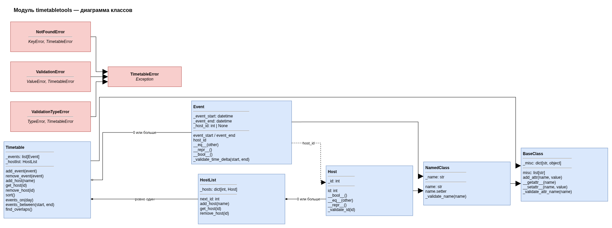
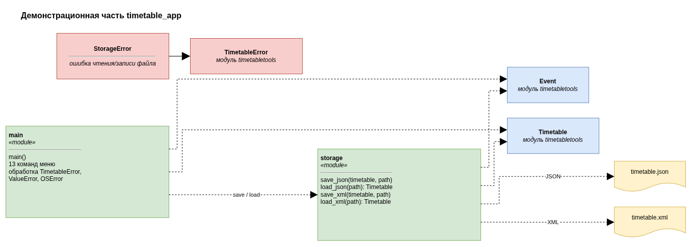

# timetabletools — модуль для работы с расписаниями

Универсальная Python-библиотека для описания и обработки расписаний:
события с интервалами времени, организаторы (ведущие) и коллекция событий
с поиском пересечений. Модуль не привязан к конкретной предметной области:
подходит для расписаний занятий, встреч, конференций, бронирований и т.п.

Репозиторий состоит из двух частей:

- **`src/timetabletools`** — сам модуль: модель данных и операции над ней.
  Он не знает о форматах хранения и не зависит от конкретного приложения.
- **`src/timetable_app`** — демонстрационное приложение. Это лишь один из
  примеров использования модуля: расписание занятий в вузе с сохранением
  данных в **JSON** и **XML**.

## Возможности модуля

- **`Host`** — организатор/ведущий события: ID, имя и произвольные атрибуты.
- **`Event`** — событие: название, начало и конец (`datetime`), необязательная
  ссылка на организатора по ID.
- **`HostList`** — коллекция организаторов с автоматической выдачей ID.
- **`Timetable`** — расписание: добавление и удаление событий и организаторов,
  сортировка, выборка по дате и диапазону, поиск пересечений.
- **`misc`** — произвольные атрибуты любого объекта: чтение как `obj.attr`,
  изменение существующих через атрибут, добавление через `add_attr`.
- Собственные исключения, совместимые со встроенными.

## Требования и запуск

Модулю нужен Python 3.10+ (используются `int | None`, `dict[str, object]`),
внешних зависимостей нет.

Запуск демонстрации:

```bash
PYTHONPATH=src python3 -m timetable_app.main
```

Либо:

```bash
cd src
python3 -m timetable_app.main
```

## Быстрый пример

```python
import datetime as dt
from timetabletools import Event, Timetable

timetable = Timetable()
host_id = timetable.add_host("Иванов Иван Иванович")

event = Event(
    "Планёрка",
    dt.datetime(2026, 11, 9, 10, 0),
    dt.datetime(2026, 11, 9, 11, 0),
    host_id=host_id,
)
event.add_attr("location", "Переговорная №3")
timetable.add_event(event)

timetable.sort()
print(timetable.events_on(dt.date(2026, 11, 9)))
```

## Структура

```
src/
├── timetabletools/            # универсальный модуль
│   ├── __init__.py            # публичный API
│   ├── base_class.py          # исключения + BaseClass + NamedClass
│   ├── host.py                # Host, NULL_ID
│   ├── event.py               # Event
│   ├── hostlist.py            # HostList
│   └── timetable.py           # Timetable
└── timetable_app/             # демонстрация (пример использования)
    ├── __init__.py
    ├── storage.py             # StorageError + save_json/load_json/
    │                          # save_xml/load_xml
    ├── main.py                # консольное меню
    └── data/
        ├── timetable.json     # пример расписания занятий
        └── timetable.xml      # пример расписания занятий
docs/
├── class-diagram-module.drawio.png  # диаграмма классов модуля
├── class-diagram-app.drawio.png     # диаграмма демо-части
└── timetabletools.md                # документация по модулю
README.md
```

## Диаграммы классов

]




## Демонстрационное приложение

Консольное меню показывает работу модуля и сохранение данных в файлы:
добавление и редактирование событий, организаторы, поиск пересечений,
выборка событий на дату, сохранение и загрузка в JSON/XML. Демо не является
частью модуля и приведено только как пример использования.

## Формат хранения демо-приложения

В демо `misc` раскрывается поэлементно; аудитория и группа — просто атрибуты
события.

JSON:

```json
{
  "meta": {"semester": "осенний"},
  "hosts": [
    {"id": 0, "name": "Иванов Иван Иванович", "post": "доцент"}
  ],
  "events": [
    {
      "name": "Математический анализ",
      "event_start": "2026-11-09T10:00:00",
      "event_end": "2026-11-09T11:30:00",
      "host_id": 0,
      "room": "ауд. 101",
      "group": "БИ-21"
    }
  ]
}
```

XML:

```xml
<Timetable>
  <Meta>
    <semester>осенний</semester>
  </Meta>
  <Hosts>
    <Host id="0">
      <name>Иванов Иван Иванович</name>
      <post>доцент</post>
    </Host>
  </Hosts>
  <Events>
    <Event>
      <name>Математический анализ</name>
      <event_start>2026-11-09T10:00:00</event_start>
      <event_end>2026-11-09T11:30:00</event_end>
      <host_id type="int">0</host_id>
      <room>ауд. 101</room>
      <group>БИ-21</group>
    </Event>
  </Events>
</Timetable>
```

## Обработка исключений

- **Собственные:** `TimetableError` → `ValidationTypeError`, `ValidationError`,
  `NotFoundError`, `StorageError`. Наследуются от встроенных
  (`TypeError`/`ValueError`/`KeyError`), поэтому совместимы с обычной
  обработкой.
- **Встроенные:** `ValueError` (неверный ввод), `FileNotFoundError`/`OSError`
  (файлы), `json.JSONDecodeError` и `ET.ParseError` (битые файлы) —
  перехватываются в меню, программа не завершается аварийно.

## Документация

- Подробное описание модуля: [`docs/timetabletools.md`](docs/timetabletools.md).
